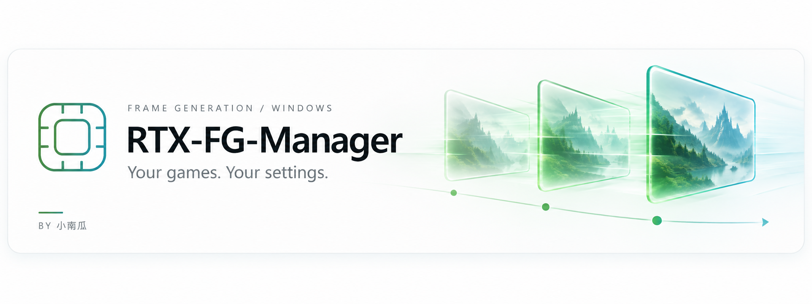
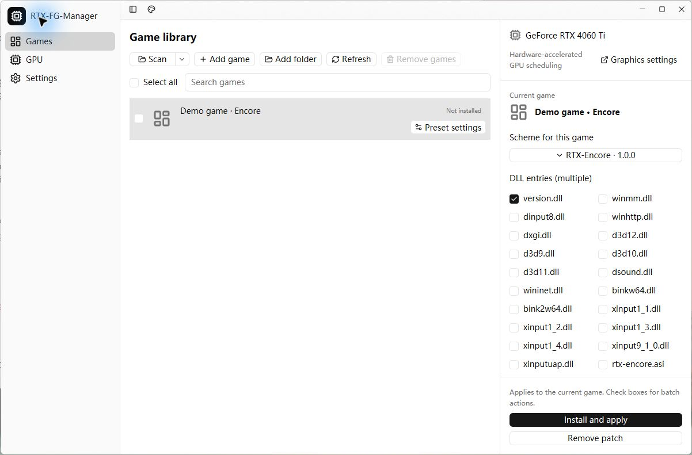

# RTX-FG-Manager

**English** · [简体中文](README.zh-CN.md)

**Your games. Your settings. One place to manage frame generation.**

[Download](#download) · [Patch guide](#choose-a-patch) · [Changelog](CHANGELOG.md) · [中文文档](README.zh-CN.md)

---

> **4.3.13 · Portable Windows x64 app. Download the signed EXE from the release links below. The manager and its patches have separate release versions.**

4.3.6 user-provided screenshot · interface illustration, not a game compatibility or performance result

## One library. Five patch choices.

**RTX-FG-Manager** is a portable Windows utility by **小南瓜** for installing, configuring, upgrading and removing supported frame-generation patches. A native Rust / GPUI interface keeps the game library in the center and the selected game's hardware, patch and actions together on the right.

| Manage | Customize | Recover |
| :--- | :--- | :--- |
| Scan or add games; individual and batch operations | A single configuration per game; supported DLL entry selection | Owned-file removal and transactional upgrade recovery |
| One complete download per scheme, reused from cache | Collapsible navigation, resizable inspector, 12–18 font sizes | Preserve unknown files, original Bink components and unrelated plugins |
| GitCode first, GitHub fallback | Light/dark themes, 38 color schemes, five interface languages | No automatic replacement of game patches when the manager updates |

## Download

**Version 4.3.13** · Windows 10 / 11 x64

| Source | Download | Purpose |
| :--- | :--- | :--- |
| **GitCode** | [Open 4.3.13 release](https://gitcode.com/gcw_qWIjmve7/RTX-FG-Manager/releases/v4.3.13) | Default domestic source |
| **GitHub** | [Open 4.3.13 release](https://github.com/pandaligx/RTX-FG-Manager/releases/tag/v4.3.13) | Primary project and fallback |
| **Gitee** | [Historical releases](https://gitee.com/pandaligx/RTX-FG-Manager/releases) | Old files retained; no new releases |

Download **`RTXManager-v4.3.13-x64.exe`** and run it. No separate Python, Rust, CUDA Toolkit or aria2 installation is needed. Patch files download when selected; a verified complete cache can be reused offline. The release includes the signed executable and checksums.

## 4.3.13 highlights

- Fix false ownership errors after DLSS/XeSS updates; recognize existing backups without clearing the cache.
- Compact player-setup comparisons, 5,000-character notes and dialogs that follow the configured font size.
- Upgrade to GPUI Kit 0.8.1, integrate RTX Encore 1.4.4 and refine recommendation animations.

[Full changelog →](CHANGELOG.md)

> Complete cloud bundles now provide **MFG 1.7.0 / Encore 1.4.4** for manager **4.3.10**. Upgrade individual games when needed; manager updates do not automatically replace installed patches.

## Choose a patch

| Scheme | What to know | Settings / menu |
| :--- | :--- | :--- |
| **Dlssg_for_sm86 · 0.4.0** | Complete FG/SR component bundle; migrates managed 0.3.5 settings. `Optimized=2` is the upstream default. | Manager / INI |
| **Dlssg_for_sm86 · 0.3.5 · 额外支持三角洲专用 · DX12/Vulkan** | Retained custom route with additional Delta Force support. Choose according to the actual game's requirements. | Manager / INI |
| **Dlssg_for_sm86-MFG-version · Vulkan** | Retained dedicated Vulkan route; not interchangeable with the DX12 routes. | Manager / INI |
| **MFG-Unlocker · 1.7.0** | Standalone DLL or an existing OptiScaler 10 plugin installation; these modes are exclusive. | **Backspace** standalone; OptiScaler menu for plugin mode |
| **RTX Encore · 1.4.4** | SR/RR/FG presets, fixed/dynamic FG, NR, Smooth Motion and compatibility controls. | **Insert**, unless the menu is disabled or its key was changed |

GPU detection provides information, not an installation gate. Each upstream patch still has its own hardware, driver, graphics API and game requirements. A selectable scheme does not guarantee compatibility. The initial scheme and 0.2.6 are retired from new installation choices; existing installations remain eligible for owned cleanup/recovery.

### RTX 20 / 30 / 40 reference

| Scheme | RTX 20 · Turing | RTX 30 · Ampere | RTX 40 · Ada |
| :--- | :--- | :--- | :--- |
| Dlssg_for_sm86 · 0.4.0 | Upstream-supported; new 0.4.0 FG kernels still lack real Turing validation | Primary supported and tested family | PTX path provided; not tested on real hardware upstream |
| 0.3.5 · Extra Delta Force support · DX12/Vulkan | Retained custom adaptation | Retained custom adaptation | Custom SM89 support provided; not a guarantee for every game |
| Dlssg_for_sm86-MFG-version · Vulkan | Upstream targets RTX 20/30; check the selected Vulkan package | Primary target family | No explicit upstream guarantee |
| MFG-Unlocker · 1.7.0 | Experimental DLSS MFG with supported 310.9 runtimes | Upstream DLSS MFG support | Upstream DLSS MFG support |
| RTX Encore · 1.4.4 | Experimental FG / NR; Smooth Motion V1/V2 requires 621.01 and DX12 | FG / NR; Smooth Motion depends on driver and API | FG / NR; NVIDIA provides Smooth Motion |

Sources: [Dlssg_for_sm86 requirements and limitations](https://github.com/sdli1995/dlssg_for_sm86), [Vulkan fork](https://github.com/pipotoufikxyz-lgtm/dlssg_for_sm86-MFG-version), [MFG-Unlocker](https://github.com/dashdogy/MFG-Unlocker), [Encore compatibility](https://github.com/SilyNoMeta/rtx-encore/blob/main/docs/COMPATIBILITY.md). The retained Delta Force package is this project's custom adaptation, not an upstream compatibility promise. This selection guide does not claim manager-side testing of every GPU or game.

MFG's DLSS route needs an existing Streamline DLSS FG integration; Preset C needs runtime 310.9.16. RTX 20 DLSS MFG is experimental and limited to 310.9.0 / 310.9.1 / 310.9.16; XeMFG is a separate route: standalone MFG 1.7 can use its private Intel 3.0.2 runtime; plugin mode uses an existing OptiScaler installation. Official 0.4.0 targets DX12; changing a DLL filename does not add Vulkan support.

### Encore feature support

| Feature | DX11 | DX12 | Vulkan |
| :--- | :--- | :--- | :--- |
| X2–X6 frame generation | — | Yes | Yes; experimental on RTX 20/30 |
| UI assist / RTX 30 Fast SR | — | Yes | — |
| RTX 30 Smooth Motion | Yes | Yes | Yes |
| Neural Rendering | Experimental | Experimental | Experimental |
| Menu / overlay | Yes | Yes | Yes |

Summary of [upstream compatibility notes](https://github.com/SilyNoMeta/rtx-encore/blob/main/docs/COMPATIBILITY.md), not universal game validation. RTX 20 FG/NR remain experimental; GTX, other GPU vendors, DX9 and OpenGL are unsupported. Smooth Motion needs qualified drivers; NR needs 310.8.0 or 310.9.16. See upstream for version requirements and game exceptions.

### Start in three steps

1. **Exit the game.** Scan your library or add the actual rendering EXE. Unreal games often use `Binaries/Win64`, rather than the launcher.
2. **Select the game and patch.** Choose the intended DLL entry, review **Preset parameters**, then use **Install and apply**. Start with a single suitable entry unless your setup specifically needs more.
3. **Launch and check.** Enable the game's supported frame-generation path. Use the menu key above when available; restart the game for settings marked as requiring restart.

Close the game before configuration changes or removal. Upgrade a managed supported installation with **Install and apply**; changing patch families generally requires removing the old patch first. Unknown collisions stop deployment instead of silently replacing files.

<b>DLL names, ASI and OptiScaler</b>

- The manager permits multiple supported DLL entries. Loading multiple copies can conflict; this is a choice, not a compatibility guarantee. ASI/plugin mode remains exclusive with standalone DLL mode.
- Encore's `version.dll`, `winmm.dll`, `dxgi.dll`, `dinput8.dll` and `rtx-encore.asi` use their corresponding upstream files. Other supported names use the main DLL. Renaming identical bytes preserves that file's signature; it does not sign separately built proxies or add graphics API support.
- For Bink loading, preserve the original as `binkw64Hooked.dll` or `bink2w64Hooked.dll` beside the patch. The manager does not automatically rename or delete the game's originals.
- MFG plugin mode requires an already installed OptiScaler 10 and its supported `OptiScaler/plugins` directory. The manager does not install OptiScaler or automatically discover custom plugin paths.

<b>Encore 1.0.0: new switches and existing settings</b>

All three new controls are in **Compatibility and hotkeys**, default to off, and require a game restart:

| Key | Use |
| :--- | :--- |
| `compatibility.disableInGameMenu` | Avoid menu attachment conflicts, including the upstream Star Wars Outlaws case. FG remains active. Disable this option in the manager and restart to restore the menu; Insert cannot bypass it. |
| `diagnostics.logDxgiWrappers` | Trace game calls to the menu swapchain when investigating crashes after menu attachment. |
| `diagnostics.crashDetails` | Add register/stack details and `.dmp` crash snapshots, often tens of MB. Turn off after collection. Dumps can contain process memory; review before sharing. |

Upgrading rc.3 preserves the existing JSONC, including comments, unknown fields and menu state. New settings are written only when edited; upgrading does not reset your configuration. SR/RR/FG presets, NR and Smooth Motion retain their existing controls. Consult [upstream settings](https://github.com/SilyNoMeta/rtx-encore/blob/v1.0.0/docs/SETTINGS.md) for feature-specific requirements.

## Update, remove and recover

| Action | Effect |
| :--- | :--- |
| **Update manager** | Updates the app. Does not automatically replace game patches. |
| **Install and apply** | Installs or upgrades the selected supported patch; preserves managed configuration where supported. |
| **Uninstall patch** | Removes owned patch components, managed state and recognized game-specific logs; restores eligible originals/settings. |
| **Remove game** | Removes the library entry only. Does not uninstall the patch. |
| **Clear cache** | Removes downloaded cache data only. Does not uninstall the patch. |

Cleanup includes dlssg frame-time/NGX logs, MFG game-specific temporary logs, and Encore session, exception, performance logs and recognized generated crash dumps. Unknown files, manual captures and other games/plugins are retained. Locked files or incomplete recovery remain visible for retry. OptiScaler fields are restored only if the manager changed them and they have not since been edited.

Resources use one complete ZIP per scheme in [Resources (not a manager update)](https://github.com/pandaligx/RTX-FG-Manager/releases/tag/payloads). The 0.4.0 package includes all required distributed components; only selected loaders are deployed. Encore's complete ZIP exceeds Gitee's per-file limit, so its download uses GitCode/GitHub.

## Frequently asked questions

<b>Which scheme or DLL is right for my game?</b>

Use the relevant upstream game's compatibility notes and the game's actual API. The filename controls how the game loads the patch; it does not turn a DX12 feature into Vulkan support. Keep one patch family at a time. If a file already belongs to another mod, choose an appropriate supported alternative or resolve the conflict first.

<b>Why is 0.4.0's kernel mode 2?</b>

`Optimized=2` is the downloaded upstream 0.4.0 INI's default, not a forced manager optimization. Existing user settings are preserved during supported upgrades.

<b>Downloads or update checks fail — what next?</b>

Retry with GitHub as the source if GitCode is unavailable, or use the release links above. A valid cached catalog/package remains usable when the network fails. Do not substitute an incomplete archive. When reporting an issue, include the app version, source and error text; avoid posting personal paths or crash dumps publicly.

<b>Does signing or a passing manager test prove game compatibility?</b>

No. Signing identifies a publisher; file, configuration and UI tests do not establish GPU performance, game compatibility or anti-cheat acceptance. Follow the game's modding rules. The previously reported RTX 3060 6GB VRAM issue is not claimed fixed by this release.

## Build and contribute

The manager is **MIT licensed**. See [Building](BUILDING.md), [Cloud maintenance](docs/cloud-publishing.md) and [GitCode distribution](docs/gitcode-publishing.md). Game DLLs retain their own licenses; NVIDIA SDK headers and private patch research are not part of the public source.

Bug reports: [GitHub Issues](https://github.com/pandaligx/RTX-FG-Manager/issues). Include the manager version, patch/version, selected entry, GPU/driver and reproducible steps. Avoid attaching game copies, credentials or personal logs.

## Credits

Thanks to [sdli1995 / dlssg_for_sm86](https://github.com/sdli1995/dlssg_for_sm86), [pipotoufikxyz-lgtm / MFG](https://github.com/pipotoufikxyz-lgtm/dlssg_for_sm86-MFG-version), [dashdogy / MFG-Unlocker](https://github.com/dashdogy/MFG-Unlocker), [SilyNoMeta / RTX Encore](https://github.com/SilyNoMeta/rtx-encore), [GPUI](https://gpui.rs/), [GPUI Kit](https://github.com/longbridge/gpui-kit), [GPUI Fast](https://github.com/longbridge/gpui-fast) and [aria2](https://github.com/aria2/aria2). See [Third-party notices](THIRD_PARTY_NOTICES.txt).

Special thanks to [大大大怪将军阁下](https://space.bilibili.com/608531525), [云外逸声](https://space.bilibili.com/256887068) and everyone contributing compatibility feedback. This project is not affiliated with NVIDIA, game publishers or the upstream projects.

---

**RTX-FG-Manager · by 小南瓜**  
[Website](https://lgxng.cn/) · [Bilibili](https://b23.tv/5mHCHFn) · [GitHub](https://github.com/pandaligx/RTX-FG-Manager) · [GitCode](https://gitcode.com/gcw_qWIjmve7/RTX-FG-Manager) · [Gitee](https://gitee.com/pandaligx/RTX-FG-Manager)

