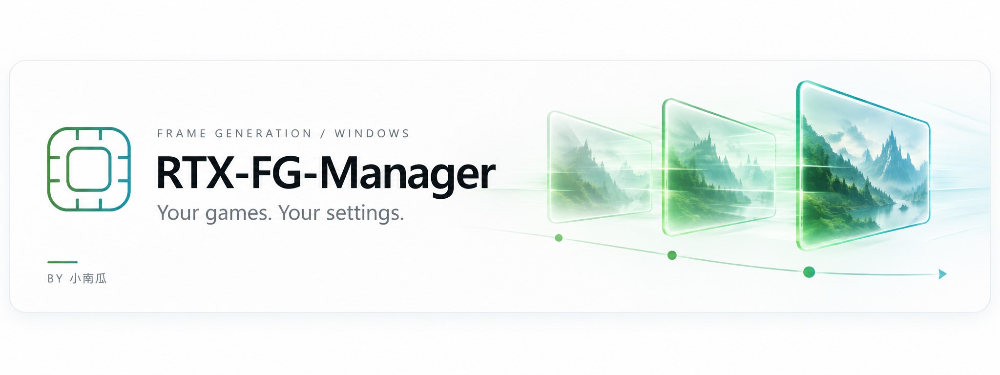
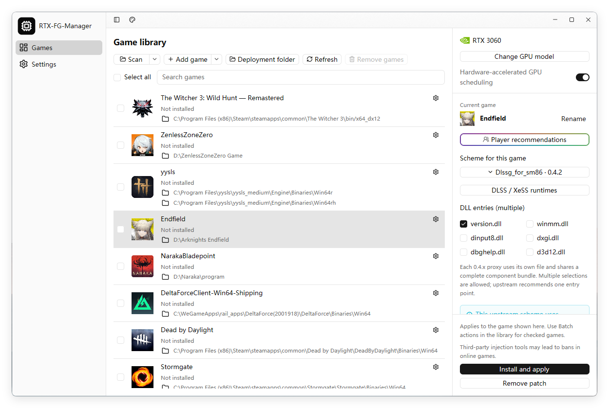

<div align="center">

# RTX-FG-Manager



**English** · [简体中文](README.zh-CN.md)

**Your games. Your settings. One place to manage frame generation.**

<a href="https://github.com/pandaligx/RTX-FG-Manager/releases/latest"></a>

<a href="BUILDING.md#linux-appimage-experimental--实验性"></a>

<a href="LICENSE"></a>
<a href="https://github.com/pandaligx/RTX-FG-Manager/stargazers"></a>

<a href="docs/download-stats.json"></a>

[Download](#download) · [Patch guide](#choose-a-patch) · [Changelog](CHANGELOG.md) · [中文文档](README.zh-CN.md)

<a href="https://gitcode.com/gcw_qWIjmve7/RTX-FG-Manager/releases/v4.3.31"></a>

[Download Linux x86_64 AppImage (experimental)](https://github.com/pandaligx/RTX-FG-Manager/releases/download/v4.3.31/RTXManager-4.3.31-x86_64.AppImage)

</div>

---

> **4.3.31 · Portable Windows x64 / experimental Linux x86_64. Choose the EXE or AppImage for your system. The manager and its patches have separate release versions.**



<p align="center"><sub>4.3.6 user-provided screenshot · interface illustration, not a game compatibility or performance result</sub></p>

## One library. Multiple patch choices.

**RTX-FG-Manager** is a portable Windows utility by **小南瓜** for installing, configuring, upgrading and removing supported frame-generation patches. A native Rust / GPUI interface keeps the game library in the center and the selected game's hardware, patch and actions together on the right. Windows is the supported release platform; the experimental Linux port manages Windows games running under Wine / Proton.

| Manage | Customize | Recover |
| :--- | :--- | :--- |
| Scan or add games; individual and batch operations | A single configuration per game; supported DLL entry selection | Owned-file removal and transactional upgrade recovery |
| One complete download per scheme, reused from cache | Collapsible navigation, resizable inspector, 12–18 font sizes | Preserve unknown files, original Bink components and unrelated plugins |
| GitCode first, GitHub fallback | Light/dark themes, 38 color schemes, five interface languages | No automatic replacement of game patches when the manager updates |

## Download

**Version 4.3.31** · Windows 10 / 11 x64 · Linux x86_64 (experimental)

| Source | Download | Purpose |
| :--- | :--- | :--- |
| **GitCode** | [Open 4.3.31 release](https://gitcode.com/gcw_qWIjmve7/RTX-FG-Manager/releases/v4.3.31) | Default domestic source |
| **GitHub** | [Open 4.3.31 release](https://github.com/pandaligx/RTX-FG-Manager/releases/tag/v4.3.31) | Primary project and fallback |
| **Linux · GitCode** | [Download AppImage](https://gitcode.com/gcw_qWIjmve7/RTX-FG-Manager/releases/download/v4.3.31/RTXManager-4.3.31-x86_64.AppImage) | Linux x86_64 domestic mirror |
| **Linux · GitHub** | [Download AppImage](https://github.com/pandaligx/RTX-FG-Manager/releases/download/v4.3.31/RTXManager-4.3.31-x86_64.AppImage) | Linux x86_64 download |
| **Gitee** | [Historical releases](https://gitee.com/pandaligx/RTX-FG-Manager/releases) | Old files retained; no new releases |

On Windows, download **`RTXManager.exe`** and run it. No separate Python, Rust or CUDA Toolkit installation is needed. Patch files download when selected; a verified complete cache can be reused offline. The release includes the signed executable and checksums.

### Linux (experimental)

Download **`RTXManager-4.3.31-x86_64.AppImage`** above; no compilation is needed. It requires x86_64, glibc 2.35 or newer (built on Ubuntu 22.04), system graphics drivers and desktop libraries. Make it executable, then launch:

```sh
chmod +x RTXManager-4.3.31-x86_64.AppImage
./RTXManager-4.3.31-x86_64.AppImage --wine-prefix "/path/to/prefix"
```

Replace the prefix with the game's actual Wine directory; Steam Proton normally uses `steamapps/compatdata/<AppID>/pfx`. Add the game's Windows EXE. Native Linux ELF games and automatic Proton launch configuration are outside this port's scope. Releases include a separate `SHA256SUMS-linux.txt`; see the [Linux instructions](BUILDING.md#linux-appimage-experimental--实验性) for dependencies, running without FUSE and source builds.

Windows-only GPU scheduling, driver modification, EXE self-updates, DPAPI login storage and process-handle repair are unavailable on Linux. The GPU guide below primarily describes upstream Windows support, not verified Wine / Proton compatibility.

## 4.3.31 highlights

- Integrates RTX Encore 2.3.0 NR Final image, exposure modes, FSR 1 and XeFG pacing controls, including player-preset sharing while preserving existing configurations.
- Shows the 0.4.1 XeSS engine explanation only when XeSS is selected; the default DLSS choice has no extra description.
- Adds experimental Linux / AppImage support while retaining the existing Windows rendering, signing and update paths.

[Full changelog →](CHANGELOG.md)

> **Dlssg_for_sm86 0.4.1** requires manager **4.3.14**; use **4.3.31 or later** for **Encore 2.3.0** settings and preset sharing. Upgrade games explicitly; manager updates do not automatically replace installed patches.

## Choose a patch

| Scheme | What to know | Settings / menu |
| :--- | :--- | :--- |
| **Dlssg_for_sm86 · 0.4.1** | Complete bundle with XeSS 2X–4X; fresh installs default to `Optimized=1`, preset A and SR off. | Manager / INI |
| **Dlssg_for_sm86 · 0.3.5 · 额外支持三角洲专用 · DX12/Vulkan** | Retained custom route with additional Delta Force support. Choose according to the actual game's requirements. | Manager / INI |
| **Dlssg_for_sm86-MFG-version · Vulkan** | Retained dedicated Vulkan route; not interchangeable with the DX12 routes. | Manager / INI |
| **MFG-Unlocker · 1.7.0** | Standalone DLL or an existing OptiScaler 10 plugin installation; these modes are exclusive. | **Backspace** standalone; OptiScaler menu for plugin mode |
| **MFG-Unlocker · 1.6.1** | Compatibility fallback; XeMFG requires the existing OptiScaler plugin route. | **Backspace** standalone; OptiScaler menu in plugin mode |
| **RTX Encore · 2.3.0** | SR/RR/FG, DLSSNR, Smooth Motion, XeSS/XeFG and Frame Pacing, plus experimental features for games without native DLSS. | **Insert**, unless disabled or rebound |

> MFG-Unlocker 1.6.1 is available as a compatibility option. Uninstall the current patch before switching versions. Preset sharing for this option is supported from manager 4.3.15.

GPU detection provides information, not an installation gate. Each upstream patch still has its own hardware, driver, graphics API and game requirements. A selectable scheme does not guarantee compatibility. The initial scheme and 0.2.6 are retired from new installation choices; existing installations remain eligible for owned cleanup/recovery.

### GPU family support

| Scheme | RTX 20 · Turing | RTX 30 · Ampere | RTX 40 · Ada | RTX 50 · Blackwell |
| :--- | :--- | :--- | :--- | :--- |
| Dlssg_for_sm86 · 0.4.1 | Supported; new FG kernels lack real Turing validation | Primary supported/tested family | PTX path provided; no hardware validation | PTX path provided; no hardware validation |
| 0.3.5 · Extra Delta Force support · DX12/Vulkan | Retained custom adaptation | Retained custom adaptation | Custom SM89 adaptation | Support unconfirmed |
| Dlssg_for_sm86-MFG-version · Vulkan | Upstream target family | Upstream target family | No explicit upstream guarantee | No explicit upstream guarantee |
| MFG-Unlocker · 1.7.0 / 1.6.1 | Experimental DLSS MFG | DLSS MFG supported | DLSS MFG supported | Native MFG with additional controls |
| RTX Encore · 2.3.0 | Experimental FG / NR; driver-limited Smooth Motion | FG / NR; Fast SR and Smooth Motion routes | FG / NR; NVIDIA native Smooth Motion | Feature-dependent; Vulkan NR awaits hardware validation |

Sources: [Dlssg_for_sm86 requirements and limitations](https://github.com/sdli1995/dlssg_for_sm86), [Vulkan fork](https://github.com/pipotoufikxyz-lgtm/dlssg_for_sm86-MFG-version), [MFG-Unlocker](https://github.com/dashdogy/MFG-Unlocker), [Encore compatibility](https://github.com/SilyNoMeta/rtx-encore/blob/main/docs/COMPATIBILITY.md). The retained Delta Force package is this project's custom adaptation, not an upstream compatibility promise. This selection guide does not claim manager-side testing of every GPU or game.

MFG's DLSS route requires an existing Streamline DLSS FG integration; Preset C needs 310.9.16, and RTX 20 requires specific 310.9 runtimes. **The experimental standalone XeMFG route in 1.7.0 can support eligible NVIDIA / AMD / Intel GPUs**, subject to Intel runtime, driver and DX12 / Vulkan requirements. This does not enable DLSS or DLSSNR on AMD / Intel. Version 1.6.1 lacks 1.7.0's standalone XeMFG route.

Dlssg_for_sm86's XeSS engine uses its own CUDA backend, not a general-purpose Intel XeSS DLL; it does not add AMD / Intel support. Official 0.4.1 targets DX12; the custom Delta Force and Vulkan packages are separate choices. Encore does not support GTX, AMD or Intel GPUs. Workstation, CMP and unlisted models have no explicit upstream guarantee; changing a GPU name cannot change its hardware capabilities.

### Encore feature support

| Feature | DX11 | DX12 | Vulkan |
| :--- | :--- | :--- | :--- |
| X2–X6 FG with native DLSS FG integration | — | Yes | Yes; experimental on RTX 20/30 |
| Added features for games without native DLSS / FG | Experimental | Experimental | Experimental |
| UI assist / RTX 30 Fast SR | — | Yes | — |
| RTX 30 Smooth Motion | Yes | Yes | Yes |
| Neural Rendering | Experimental | Experimental | Experimental |
| Menu / overlay | Yes | Yes | Yes |

Summary of [upstream compatibility notes](https://github.com/SilyNoMeta/rtx-encore/blob/main/docs/COMPATIBILITY.md), not universal game validation. RTX 20 FG/NR remain experimental; GTX, other GPU vendors, DX9 and OpenGL are unsupported. Smooth Motion needs qualified drivers; NR needs 310.8.0 or 310.9.16. See upstream for version requirements and game exceptions.

### Start in three steps

1. **Exit the game.** Scan your library or add the actual rendering EXE. Unreal games often use `Binaries/Win64`, rather than the launcher.
2. **Select the game and patch.** Choose the intended DLL entry, review **Preset parameters**, then use **Install and apply**. Start with a single suitable entry unless your setup specifically needs more.
3. **Launch and check.** Enable the game's supported frame-generation path. Use the menu key above when available; restart the game for settings marked as requiring restart.

Close the game before configuration changes or removal. Upgrade a managed supported installation with **Install and apply**; changing patch families generally requires removing the old patch first. Unknown collisions stop deployment instead of silently replacing files.

<details>
<summary><b>DLL names, ASI and OptiScaler</b></summary>

- The manager permits multiple supported DLL entries. Loading multiple copies can conflict; this is a choice, not a compatibility guarantee. ASI/plugin mode remains exclusive with standalone DLL mode.
- Encore's `version.dll`, `winmm.dll`, `dxgi.dll`, `dinput8.dll` and `rtx-encore.asi` use their corresponding upstream files. Other supported names use the main DLL. Renaming identical bytes preserves that file's signature; it does not sign separately built proxies or add graphics API support.
- For Bink loading, preserve the original as `binkw64Hooked.dll` or `bink2w64Hooked.dll` beside the patch. The manager does not automatically rename or delete the game's originals.
- MFG plugin mode requires an already installed OptiScaler 10 and its supported `OptiScaler/plugins` directory. The manager does not install OptiScaler or automatically discover custom plugin paths.

</details>

<details>
<summary><b>Encore 2.3.0: components and existing settings</b></summary>

Select components in **DLSS / XeSS runtimes** and enable features in **Preset parameters**. Encore can experimentally add features to games without native DLSS / FG; these are not enabled for you by default. Added DLSS-G / Streamline and Intel components follow the installation's requirements; owned originals are backed up and restored.

The manager and preset-sharing service support 2.3.0 NR Final image, game motion vectors, exposure modes, FSR 1 and XeFG pacing controls. Upgrades retain JSONC comments, unknown fields and menu state; older shares retain their own protocol. See [2.3.0 settings](https://github.com/SilyNoMeta/rtx-encore/blob/v2.3.0/docs/SETTINGS.md) and [games without DLSS](https://github.com/SilyNoMeta/rtx-encore/blob/v2.3.0/docs/GAMES-WITHOUT-DLSS.md).

</details>

## Update, remove and recover

| Action | Effect |
| :--- | :--- |
| **Update manager** | Updates the app. Does not automatically replace game patches. |
| **Install and apply** | Installs or upgrades the selected supported patch; preserves managed configuration where supported. |
| **Uninstall patch** | Removes owned patch components, managed state and recognized game-specific logs; restores eligible originals/settings. |
| **Remove game** | Removes the library entry only. Does not uninstall the patch. |
| **Clear cache** | Removes downloaded cache data only. Does not uninstall the patch. |

Cleanup includes dlssg frame-time/NGX logs, MFG game-specific temporary logs, and Encore session, exception, performance logs and recognized generated crash dumps. Unknown files, manual captures and other games/plugins are retained. Locked files or incomplete recovery remain visible for retry. OptiScaler fields are restored only if the manager changed them and they have not since been edited.

Resources use one complete ZIP per scheme in [Resources (not a manager update)](https://github.com/pandaligx/RTX-FG-Manager/releases/tag/payloads). The 0.4.1 package includes all required distributed components; only selected loaders are deployed. Resources are distributed through GitCode/GitHub, with optional runtimes managed separately.

## Frequently asked questions

<details>
<summary><b>Which scheme or DLL is right for my game?</b></summary>

Use the relevant upstream game's compatibility notes and the game's actual API. The filename controls how the game loads the patch; it does not turn a DX12 feature into Vulkan support. Keep one patch family at a time. If a file already belongs to another mod, choose an appropriate supported alternative or resolve the conflict first.

</details>

<details>
<summary><b>Why is 0.4.0's kernel mode 2?</b></summary>

0.4.0 defaults to `Optimized=2`; fresh 0.4.1 installs default to `Optimized=1`. Manager 4.3.15 fixes stale cached defaults: reinstall the patch if affected, without deleting manager data. Explicit settings in existing installations are preserved.

</details>

<details>
<summary><b>Downloads or update checks fail — what next?</b></summary>

Retry with GitHub as the source if GitCode is unavailable, or use the release links above. A valid cached catalog/package remains usable when the network fails. Do not substitute an incomplete archive. When reporting an issue, include the app version, source and error text; avoid posting personal paths or crash dumps publicly.

</details>

<details>
<summary><b>Does signing or a passing manager test prove game compatibility?</b></summary>

No. Signing identifies a publisher; file, configuration and UI tests do not establish GPU performance, game compatibility or anti-cheat acceptance. Follow the game's modding rules. The previously reported RTX 3060 6GB VRAM issue is not claimed fixed by this release.

</details>

## Build and contribute

The manager is **MIT licensed**. See [Building](BUILDING.md), [Cloud maintenance](docs/cloud-publishing.md) and [GitCode distribution](docs/gitcode-publishing.md). Game DLLs retain their own licenses; NVIDIA SDK headers and private patch research are not part of the public source.

Bug reports: [GitHub Issues](https://github.com/pandaligx/RTX-FG-Manager/issues). Include the manager version, patch/version, selected entry, GPU/driver and reproducible steps. Avoid attaching game copies, credentials or personal logs.

## Credits

Thanks to [sdli1995 / dlssg_for_sm86](https://github.com/sdli1995/dlssg_for_sm86), [pipotoufikxyz-lgtm / MFG](https://github.com/pipotoufikxyz-lgtm/dlssg_for_sm86-MFG-version), [dashdogy / MFG-Unlocker](https://github.com/dashdogy/MFG-Unlocker), [SilyNoMeta / RTX Encore](https://github.com/SilyNoMeta/rtx-encore), [GPUI](https://gpui.rs/), [GPUI Kit](https://github.com/longbridge/gpui-kit), [GPUI Fast](https://github.com/longbridge/gpui-fast) and [reqwest](https://github.com/seanmonstar/reqwest) / [Tokio](https://github.com/tokio-rs/tokio). See [Third-party notices](THIRD_PARTY_NOTICES.txt).

Special thanks to [大大大怪将军阁下](https://space.bilibili.com/608531525), [云外逸声](https://space.bilibili.com/256887068), [坏坏的帅帅啊](https://space.bilibili.com/296225145) and everyone contributing compatibility feedback. This project is not affiliated with NVIDIA, game publishers or the upstream projects.

Thanks to [落日无序的米莉安](https://www.xiaoheihe.cn/bbs/user_profile_share?user_id=c7cf681e8605&h_src=heyboxapp) on HeyBox for sharing the manager and creating tutorials.

---

<div align="center">

**RTX-FG-Manager · by 小南瓜**  
[Website](https://lgxng.cn/) · [Bilibili](https://b23.tv/5mHCHFn) · [GitHub](https://github.com/pandaligx/RTX-FG-Manager) · [GitCode](https://gitcode.com/gcw_qWIjmve7/RTX-FG-Manager) · [Gitee](https://gitee.com/pandaligx/RTX-FG-Manager)

</div>
