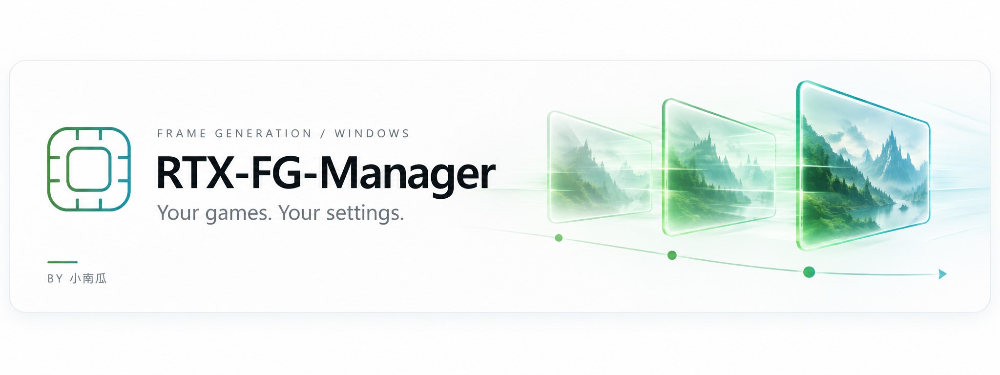
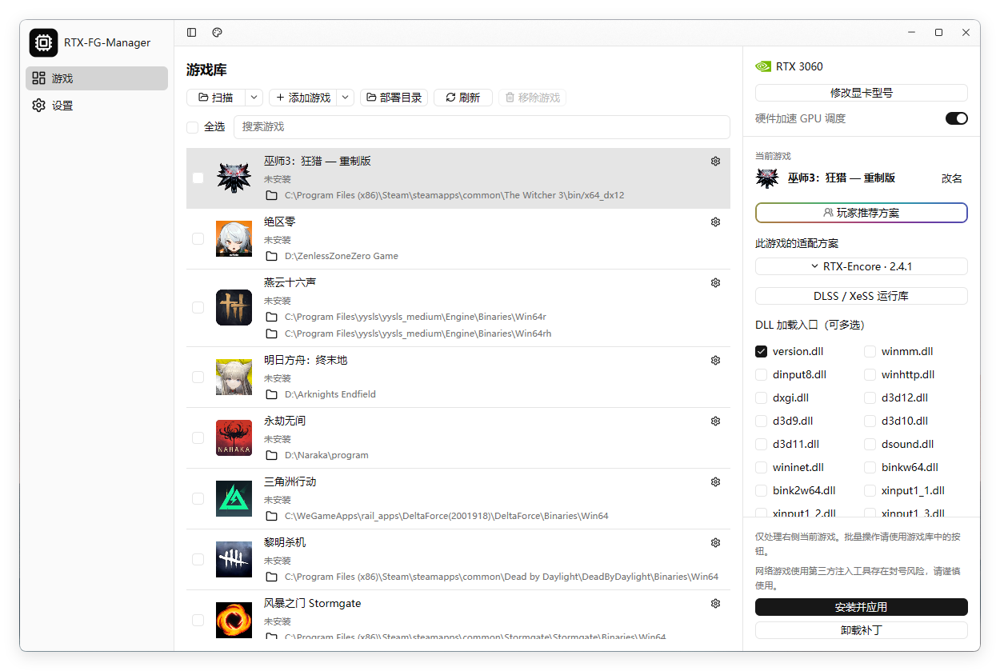

<div align="center">

# RTX-FG-Manager



**简体中文** · [English](README.md)

**游戏、补丁、参数，集中管理。**

<a href="https://github.com/pandaligx/RTX-FG-Manager/releases/latest"></a>

<a href="BUILDING.md#linux-appimage-experimental--实验性"></a>

<a href="LICENSE"></a>
<a href="https://github.com/pandaligx/RTX-FG-Manager/stargazers"></a>

<a href="docs/download-stats.json"></a>

[下载软件](#下载) · [选择方案](#方案怎么选) · [更新日志](CHANGELOG.zh-CN.md) · [English](README.md)

<a href="https://gitcode.com/gcw_qWIjmve7/RTX-FG-Manager/releases/download/v4.3.35/RTXManager.exe"></a>
<a href="https://gitcode.com/gcw_qWIjmve7/RTX-FG-Manager/releases/download/v4.3.35/RTXManager-4.3.35-x86_64.AppImage"></a>

</div>

---

> **4.3.35 · Windows x64 便携版 / Linux x86_64 实验版。按系统选择 EXE 或 AppImage。管理器与各补丁的版本分别管理。**



<p align="center"><sub>用户提供的中文界面截图</sub></p>

## 一个游戏库，多种补丁方案

**RTX-FG-Manager** 是由 **小南瓜** 维护的 Windows 便携工具，集中管理受支持插帧补丁的安装、配置、升级与卸载。原生 Rust / GPUI 界面以游戏库为中心，在右侧集中展示所选游戏、硬件、补丁和操作。 Windows 为正式支持平台；Linux 为实验性移植，用于 Wine / Proton 下的 Windows 游戏。

| 管理更集中 | 设置更顺手 | 恢复有依据 |
| :--- | :--- | :--- |
| 扫描或手动添加游戏，支持单个与批量操作 | 每款游戏一份配置，自由选择受支持 DLL | 卸载时恢复原文件，安装失败可回退 |
| 每方案一个完整包，下载缓存可复用 | 折叠侧栏、可拖动右栏、12–18 字号调节 | 保留未知文件、原始 Bink 文件及其他插件 |
| 默认 GitCode，失败回退 GitHub | 明暗主题、38 套配色、五种界面语言 | 更新管理器不会自动替换游戏补丁 |

## 下载

**版本 4.3.35** · Windows 10 / 11 x64 · Linux x86_64（实验性）

| 来源 | 下载入口 | 用途 |
| :--- | :--- | :--- |
| **GitCode** | [打开 4.3.35 发行页](https://gitcode.com/gcw_qWIjmve7/RTX-FG-Manager/releases/v4.3.35) | 国内默认下载源 |
| **GitHub** | [打开 4.3.35 发行页](https://github.com/pandaligx/RTX-FG-Manager/releases/tag/v4.3.35) | 主项目与备用源 |
| **Linux · GitCode** | [下载 AppImage](https://gitcode.com/gcw_qWIjmve7/RTX-FG-Manager/releases/download/v4.3.35/RTXManager-4.3.35-x86_64.AppImage) | Linux x86_64 国内下载 |
| **Linux · GitHub** | [下载 AppImage](https://github.com/pandaligx/RTX-FG-Manager/releases/download/v4.3.35/RTXManager-4.3.35-x86_64.AppImage) | Linux x86_64 备用下载 |

Windows 用户下载 **`RTXManager.exe`** 后运行，无需另装 Python、Rust或 CUDA Toolkit。补丁按需下载，完整且校验通过的缓存可离线复用；发行附件提供签名 EXE 与校验摘要。

### Linux（实验性）

下载上方 **`RTXManager-4.3.35-x86_64.AppImage`** 即可，无需自行编译。要求 x86_64、glibc 2.35 或更新版本（构建基线 Ubuntu 22.04），以及系统图形驱动和桌面运行库。赋予执行权限后启动：

```sh
chmod +x RTXManager-4.3.35-x86_64.AppImage
./RTXManager-4.3.35-x86_64.AppImage --wine-prefix "/path/to/prefix"
```

将前缀路径替换为游戏实际使用的 Wine 目录；Steam Proton 通常选择 `steamapps/compatdata/<AppID>/pfx`。再添加游戏的 Windows EXE，不用于原生 Linux ELF 游戏，也不自动配置 Proton 启动参数。发行页提供独立的 `SHA256SUMS-linux.txt`；依赖、免 FUSE 启动和源码构建见[Linux 说明](BUILDING.md#linux-appimage-experimental--实验性)。

AppImage 支持独立自动更新。Windows 专属的 GPU 调度、驱动修改、EXE 自动更新、DPAPI 登录存储及进程占用修复不适用于 Linux。下方显卡支持范围主要面向 Windows，不能直接视为 Wine / Proton 游戏兼容性保证。

## 4.3.35 更新亮点

- 原版 Dlssg_for_sm86 升级至 **0.4.2**，沿用上游默认配置；升级保留已修改参数，卸载后重装恢复默认。
- **ANR FG 更新至 V.B16**，使用新版模型，保留 B15 配置与玩家参数。
- 三角洲方案升级至 0.4.2 6X，保留旧三角洲 0.3.5、MFG 和 Encore。管理器更新不会自动替换游戏补丁。

[查看完整更新日志 →](CHANGELOG.zh-CN.md)

## 方案怎么选

| 方案 | 主要说明 | 参数 / 菜单 |
| :--- | :--- | :--- |
| **Dlssg_for_sm86 · 0.4.2** | 完整组件包，含 XeSS 2X–4X；新安装默认 `Optimized=1`、预设 A、SR 关闭。 | 管理器 / INI |
| **Dlssg_for_sm86 · 0.4.2 · 额外支持三角洲专用 · DX12/Vulkan** | 私有 Streamline 2.14.16；DLSS 最高 6X、默认 4X，XeSS 最高 4X。Vulkan XeSS 改变分辨率需重启游戏。 | 管理器 / INI |
| **Dlssg_for_sm86 · 0.3.5 · 额外支持三角洲专用 · DX12/Vulkan** | 保留额外支持三角洲的自定义方案，按游戏实际要求选择。 | 管理器 / INI |
| **Dlssg_for_sm86-MFG-version · Vulkan** | 保留专用 Vulkan 方案，与 DX12 路线不可混为一谈。 | 管理器 / INI |
| **MFG-Unlocker · 1.7.1** | 普通安装仍使用独立 DLL；已有完整 OptiScaler 10 时可选插件模式，备份并更新配套主文件。两种模式互斥。 | 独立模式 **Backspace**；插件模式用 OptiScaler 菜单 |
| **MFG-Unlocker · 1.6.1** | 兼容备用版本；XeMFG 仅用于已有 OptiScaler 的插件模式。 | 独立模式 **Backspace**；插件模式用 OptiScaler 菜单 |
| **RTX Encore · 2.4.1** | SR/RR/FG、DLSSNR、Smooth Motion、XeSS/XeFG 与 Frame Pacing；可实验性地为无原生 DLSS 的游戏添加功能。 | **Insert**，禁用菜单或修改快捷键后除外 |
| **ANR FG · V.B16** | 完整包含 OptiScaler、模型和运行文件；单入口安装，默认最高 6X。适用于未安装 OptiScaler 的游戏。 | **Insert（Ins）** 打开菜单；也可在管理器中设置 |

显卡检测仅供参考，不限制方案安装。各补丁仍受上游硬件、驱动、图形 API 和游戏要求约束，能选择不等于必定兼容。

### 各方案的显卡支持范围

| 方案 | RTX 20 · Turing | RTX 30 · Ampere | RTX 40 · Ada | RTX 50 · Blackwell |
| :--- | :--- | :--- | :--- | :--- |
| Dlssg_for_sm86 · 0.4.2 | 支持 | 支持 | 支持 | 支持 |
| 0.4.2 · 三角洲专用 · DX12/Vulkan | 支持 | 支持 | 支持 | 支持 |
| 0.3.5 · 三角洲专用 · DX12/Vulkan | 支持 | 支持 | 支持 | 不支持 |
| Dlssg_for_sm86-MFG-version · Vulkan | 支持 | 支持 | 不支持 | 不支持 |
| MFG-Unlocker · 1.7.1 / 1.6.1 | 支持 | 支持 | 支持 | 支持 |
| RTX Encore · 2.4.1 | 支持 | 支持 | 支持 | 支持 |
| ANR FG · V.B16 | 支持 | 支持 | 支持 | 支持 |

依据：[Dlssg_for_sm86](https://github.com/sdli1995/dlssg_for_sm86)、[Vulkan 分支](https://github.com/pipotoufikxyz-lgtm/dlssg_for_sm86-MFG-version)、[MFG-Unlocker](https://github.com/dashdogy/MFG-Unlocker)、[Encore 兼容性](https://github.com/SilyNoMeta/rtx-encore/blob/main/docs/COMPATIBILITY.md)。“不支持”表示未纳入当前分发方案的明确支持范围；实验性功能、驱动和运行库条件仍适用，不保证所有游戏兼容。三角洲方案为本项目自定义适配。

MFG 的 DLSS 路线要求游戏已有 Streamline DLSS FG 接入；Preset C 需 310.9.16，RTX 20 限特定 310.9 运行库。**1.7.1 的 XeMFG 是独立实验路线，可用于符合条件的 NVIDIA / AMD / Intel 显卡**，需匹配 Intel 运行库、驱动及 DX12 / Vulkan 游戏；这不代表 AMD / Intel 获得 DLSS 或 DLSSNR 支持。1.6.1 没有 1.7.0 的独立 XeMFG 路线。

Dlssg_for_sm86 的 XeSS 引擎使用自身 CUDA 后端，不等于通用 Intel XeSS DLL，也不因此支持 AMD / Intel。原版 0.4.2 面向 DX12；三角洲和 Vulkan 方案另行选择。Encore 不支持 GTX、AMD 或 Intel 显卡。专业卡、CMP 及未列出的型号未获上游明确保证；修改名称不会改变硬件能力。

**ANR FG 同时支持 N 卡、A 卡和 I 卡：**

| 厂商 | 上游列出的显卡 |
| :--- | :--- |
| NVIDIA | GeForce RTX 20 / 30 / 40 / 50、GTX 16 |
| AMD | Radeon RX 5000 / 6000 / 7000 / 9000、Steam Deck |
| Intel | Arc A / B |

来源：[ANR 上游说明](https://github.com/apex-compute/ANR)。ANR FG 是帧生成功能，不等于 DLSS 神经渲染，也不会给 AMD / Intel 显卡添加 NVIDIA DLSS。具体游戏仍须满足上游要求。

### 三步开始

1. **退出游戏。** 扫描游戏库或手动添加真正负责渲染的 EXE；虚幻引擎游戏通常在 `Binaries/Win64`，不要只选启动器。
2. **选择游戏和方案。** 确认 DLL 入口，在 **预设参数** 中查看设置，然后点击 **安装并应用**。没有特殊需求时先使用一个合适入口。
3. **启动并检查。** 在游戏中启用其支持的插帧功能；有菜单的方案按上表快捷键打开。标注需重启的参数，在退出并重开游戏后生效。

修改配置和卸载前请退出游戏。受管理且支持升级的安装可用“安装并应用”更新；切换补丁家族通常需要先卸载旧方案。遇到未知同名文件时会停止部署，避免直接覆盖。

<details>
<summary><b>DLL 名称、ASI 与 OptiScaler 的区别</b></summary>

- 部分方案支持多选 DLL，ANR 每次只能选一个入口。多个入口可能重复加载并产生冲突；开放选择不代表已验证所有组合。ASI / 插件模式仍与独立 DLL 模式互斥。
- Encore 的 `version.dll`、`winmm.dll`、`dxgi.dll`、`dinput8.dll` 与 `rtx-encore.asi` 使用上游对应文件，其他受支持名称使用主 DLL。原字节重命名保留原签名，不会替单独编译的代理签名，也不会增加图形 API 支持。
- 使用 Bink 入口时，原文件应保留在补丁旁并命名为 `binkw64Hooked.dll` 或 `bink2w64Hooked.dll`。管理器不会自动改名或删除游戏原件。
- MFG 插件模式要求已安装 OptiScaler 10，使用受支持的 `OptiScaler/plugins` 目录；管理器不自动安装 OptiScaler，也不自动识别自定义插件搜索路径。

</details>

<details>
<summary><b>Encore 2.4.1：组件选择与配置保留</b></summary>

在 **DLSS / XeSS 运行库** 中按需选择组件，在 **预设参数** 中启用功能。若游戏没有原生 DLSS / 帧生成，可选择 Encore 的对应实验功能；默认不替用户启用。额外 DLSS-G / Streamline 与 Intel 组件按安装条件部署，已有组件按归属备份和恢复。

2.4.0 的逐遍 NR 处理位置及 33–100% 自定义 DLSS 比例已接入管理器和玩家分享。显式更新原生 Streamline SR/RR 时补齐配套公共组件，并保留恢复记录。升级保留已有 JSONC 注释、未知字段和菜单状态。详见 [2.4.0 参数文档](https://github.com/SilyNoMeta/rtx-encore/blob/v2.4.0/docs/SETTINGS.md)与[无原生 DLSS 游戏说明](https://github.com/SilyNoMeta/rtx-encore/blob/v2.4.0/docs/GAMES-WITHOUT-DLSS.md)。

</details>

<details>
<summary><b>ANR FG 怎么用？</b></summary>

1. 退出游戏，卸载此前安装的其他插帧补丁。已有 OptiScaler 的游戏请先恢复原安装，或按上游说明使用 addon；管理器不会自动合并它们。
2. 选择 **ANR FG V.B16**。DX12 通常用 `dxgi.dll`，Vulkan 用 `winmm.dll`；只选一个入口，点击安装。
3. 游戏内开启 **DLSS 帧生成 / NVIDIA 帧生成**，由 ANR 替换处理。按 **Insert（Ins）** 打开菜单。默认倍率上限为 6X，实际倍率取决于游戏。

Windows 需要 Microsoft Visual C++ 2015–2022 x64 运行库。Linux / Proton 还需为该游戏设置相应 DLL override，例如 `dxgi=n,b` 或 `winmm=n,b`。完整包必须保留模型文件，不要只复制 DLL。

</details>

## 更新、卸载与恢复

| 操作 | 实际影响 |
| :--- | :--- |
| **更新管理器** | 更新软件，不自动替换游戏中的补丁。 |
| **安装并应用** | 安装或升级所选受支持补丁，按适配规则保留配置。 |
| **卸载补丁** | 清理所属补丁组件、状态及已识别的游戏专属日志，并恢复符合条件的原件/设置。 |
| **移除游戏** | 只移除游戏库条目，不卸载补丁。 |
| **清理缓存** | 只清理下载缓存，不卸载补丁。 |

卸载覆盖 dlssg 帧时间/NGX 日志、MFG 对应该游戏的临时日志、Encore 会话/异常/性能日志、ANR 配置和专属日志，以及符合上游命名规则的崩溃转储。未知文件、手动抓取和其他游戏/插件保留；占用文件或未完成恢复可重试。MFG 插件模式的 OptiScaler 配置只恢复管理器修改、且之后未被用户再次改动的字段。

每个方案一个完整 ZIP，统一放在 [Resources (not a manager update)](https://github.com/pandaligx/RTX-FG-Manager/releases/tag/payloads)。0.4.2 和 ANR 均提供完整包，只部署所选入口及其配套组件。资源由 GitCode / GitHub 分发，可选运行库单独管理。

## 常见问题

<details>
<summary><b>不清楚游戏应该选择什么方案、什么 DLL？</b></summary>

先查看对应上游的游戏兼容说明，确认游戏实际使用的图形 API。DLL 名称决定加载方式，不会把 DX12 功能变成 Vulkan 支持。同一游戏保持一个补丁家族；如果入口文件已属于其他模组，选择合适的受支持入口或先解决冲突。

</details>

<details>
<summary><b>重新安装后会保留上次的参数吗？</b></summary>

升级已有补丁会保留参数；完整卸载后重新安装会使用当前方案的默认值。原版 0.4.2 默认为 `Optimized=1`、DLSS 4X、预设 A、SR 关闭；也可在预设参数中恢复默认。

</details>

<details>
<summary><b>清单下载或检测更新失败怎么办？</b></summary>

GitCode 暂时不可用时，切换 GitHub 来源重试，或从上方发行页手动下载。联网失败可继续使用有效清单和完整缓存，不要用未完成的压缩包替换资源。反馈时提供软件版本、下载源和错误文字，避免公开个人路径或崩溃转储。

</details>

<details>
<summary><b>已签名、测试通过，是否代表游戏一定有效？</b></summary>

不代表。签名标识发布者；文件、配置和界面测试不能替代 GPU 性能、游戏兼容性或反作弊验收。请遵守游戏的模组规则。

</details>

## 构建与参与

管理器采用 **MIT 许可证**。参阅 [构建说明](BUILDING.md)、[云端维护](docs/cloud-publishing.md) 和 [GitCode 分发](docs/gitcode-publishing.md)。游戏 DLL 保留各自许可；公开源码不包含 NVIDIA SDK 头文件或私有补丁研究。

问题反馈：[GitHub Issues](https://github.com/pandaligx/RTX-FG-Manager/issues)。请附管理器版本、方案/版本、入口、显卡/驱动和复现步骤，不要附游戏副本、凭据或个人日志。

## 致谢

感谢 [sdli1995 / dlssg_for_sm86](https://github.com/sdli1995/dlssg_for_sm86)、[pipotoufikxyz-lgtm / MFG](https://github.com/pipotoufikxyz-lgtm/dlssg_for_sm86-MFG-version)、[dashdogy / MFG-Unlocker](https://github.com/dashdogy/MFG-Unlocker)、[SilyNoMeta / RTX Encore](https://github.com/SilyNoMeta/rtx-encore)、[apex-compute / ANR](https://github.com/apex-compute/ANR)、[GPUI](https://gpui.rs/)、[GPUI Kit](https://github.com/longbridge/gpui-kit)、[GPUI Fast](https://github.com/longbridge/gpui-fast) 与 [reqwest](https://github.com/seanmonstar/reqwest) / [Tokio](https://github.com/tokio-rs/tokio)。详见 [第三方说明](THIRD_PARTY_NOTICES.txt)。

特别感谢 [大大大怪将军阁下](https://space.bilibili.com/608531525)、[云外逸声](https://space.bilibili.com/256887068)、[坏坏的帅帅啊](https://space.bilibili.com/296225145) 和提供兼容性反馈的用户。本项目与 NVIDIA、游戏厂商及上游项目无官方隶属关系。

感谢小黑盒博主 [落日无序的米莉安](https://www.xiaoheihe.cn/bbs/user_profile_share?user_id=c7cf681e8605&h_src=heyboxapp) 分享本软件并制作使用教程。

---

<div align="center">

**RTX-FG-Manager · by 小南瓜**  
[个人网站](https://lgxng.cn/) · [哔哩哔哩](https://b23.tv/5mHCHFn) · [GitHub](https://github.com/pandaligx/RTX-FG-Manager) · [GitCode](https://gitcode.com/gcw_qWIjmve7/RTX-FG-Manager) · [Gitee](https://gitee.com/pandaligx/RTX-FG-Manager)

</div>
