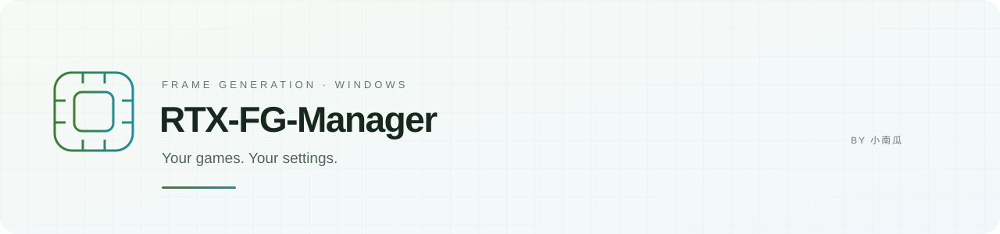
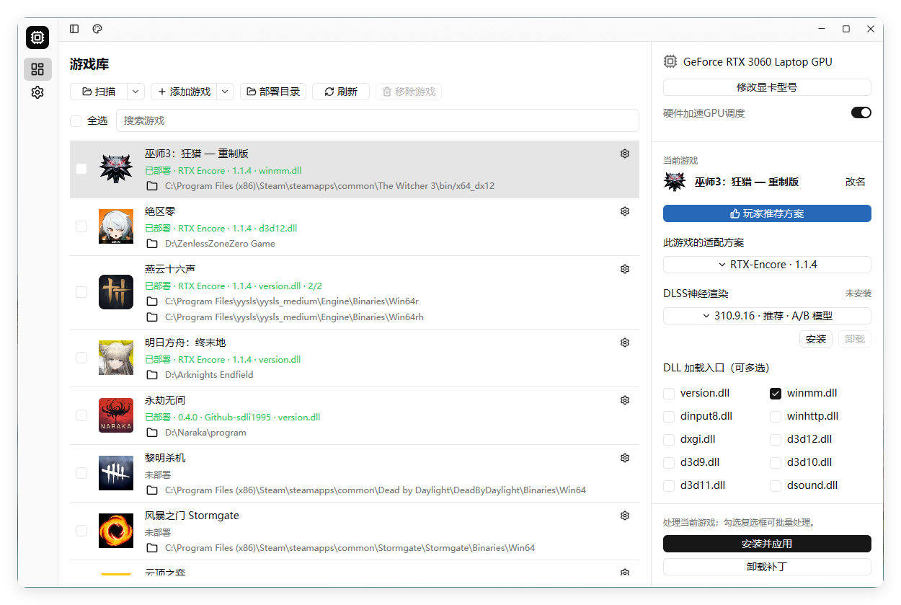

# RTX-FG-Manager

**简体中文** · [English](README.md)

**游戏、补丁、参数，集中管理。**

[下载软件](#下载) · [选择方案](#方案怎么选) · [更新日志](CHANGELOG.zh-CN.md) · [English](README.md)

---

> **4.3.2 · Windows x64 便携版。从下方发行页下载签名 EXE 即可。管理器与各补丁的版本分别管理。**

4.3.1 实际界面截图 · 演示库使用不可执行的占位 EXE · 不代表游戏运行或性能结果

## 一个游戏库，五种补丁方案

**RTX-FG-Manager** 是由 **小南瓜** 维护的 Windows 便携工具，集中管理受支持插帧补丁的安装、配置、升级与卸载。原生 Rust / GPUI 界面以游戏库为中心，在右侧集中展示所选游戏、硬件、补丁和操作。

| 管理更集中 | 设置更顺手 | 恢复有依据 |
| :--- | :--- | :--- |
| 扫描或手动添加游戏，支持单个与批量操作 | 每款游戏一份配置，自由选择受支持 DLL | 按文件归属卸载，升级失败支持事务恢复 |
| 每方案一个完整包，下载缓存可复用 | 折叠侧栏、可拖动右栏、12–18 字号调节 | 保留未知文件、原始 Bink 文件及其他插件 |
| 默认 GitCode，失败回退 GitHub | 明暗主题、38 套配色、五种界面语言 | 更新管理器不会自动替换游戏补丁 |

## 下载

**版本 4.3.2** · Windows 10 / 11 x64

| 来源 | 下载入口 | 用途 |
| :--- | :--- | :--- |
| **GitCode** | [打开 4.3.2 发行页](https://gitcode.com/gcw_qWIjmve7/RTX-FG-Manager/releases/v4.3.2) | 国内默认下载源 |
| **GitHub** | [打开 4.3.2 发行页](https://github.com/pandaligx/RTX-FG-Manager/releases/tag/v4.3.2) | 主项目与备用源 |
| **Gitee** | [打开 4.3.2 发行页](https://gitee.com/pandaligx/RTX-FG-Manager/releases/tag/v4.3.2) | 保留给现有用户的过渡入口 |

下载 **`RTXManager-v4.3.2-x64.exe`** 后运行，无需另装 Python、Rust、CUDA Toolkit 或 aria2。补丁按需下载，完整且校验通过的缓存可离线复用；发行附件提供签名 EXE 与校验摘要。

下载量徽章统计 **GitHub 全部发行附件**，包含补丁资源；不代表独立用户数，也不包含 GitCode 和 Gitee 的下载量。

## 4.3.2 更新亮点

- 适配 Encore 1.1.0，提供可选 DLSS神经渲染运行库下载、状态显示、独立卸载及原件恢复。
- 改进多种引擎目录的 DLSS 识别；修复游戏名称、图标和《巫师 3》DX12 渲染目标。
- 游戏库支持拖动排序并保存；移除确认显示图标、游戏名称和路径，字号跟随设置。
- 参数应用、恢复默认及待应用提示始终可见；关闭有未应用修改的窗口时提醒。
- 显示清理未完成的原因并提供重试；后台游戏占用时，可确认结束对应进程后重试。

更新管理器不会自动替换游戏补丁。NR 默认关闭，需要兼容的游戏 DLSS 输出与深度输入；具体支持以补丁上游说明为准。

[查看完整更新日志 →](CHANGELOG.zh-CN.md)

## 方案怎么选

| 方案 | 主要说明 | 参数 / 菜单 |
| :--- | :--- | :--- |
| **Dlssg_for_sm86 · 0.4.0** | FG/SR 完整组件包；支持受管理的 0.3.5 配置迁移。`Optimized=2` 是上游默认值。 | 管理器 / INI |
| **Dlssg_for_sm86 · 0.3.5 · 额外支持三角洲专用 · DX12/Vulkan** | 保留额外支持三角洲的自定义方案，按游戏实际要求选择。 | 管理器 / INI |
| **Dlssg_for_sm86-MFG-version · Vulkan** | 保留专用 Vulkan 方案，与 DX12 路线不可混为一谈。 | 管理器 / INI |
| **MFG-Unlocker · 1.5.0-hotfix.1** | 独立 DLL 或已有 OptiScaler 10 的插件模式，两者互斥。 | 独立模式 **Backspace**；插件模式用 OptiScaler 菜单 |
| **RTX Encore · 1.1.0** | SR/RR/FG 独立预设、固定/动态插帧、NR、Smooth Motion 与兼容性设置。 | **Insert**，禁用菜单或修改快捷键后除外 |

显卡检测仅供参考，不限制方案安装。各补丁仍受上游硬件、驱动、图形 API 和游戏要求约束，能选择不等于必定兼容。初始方案与 0.2.6 不再提供新安装入口，旧安装仍保留归属识别、恢复与卸载能力。

### RTX 20 / 30 / 40 系列参考

| 方案 | RTX 20 · Turing | RTX 30 · Ampere | RTX 40 · Ada |
| :--- | :--- | :--- | :--- |
| Dlssg_for_sm86 · 0.4.0 | 上游支持；0.4.0 新 FG 内核尚缺真实 Turing 验证 | 上游主要支持与测试系列 | 上游提供 PTX 路径，但未实机验证 |
| 0.3.5 · 三角洲专用 · DX12/Vulkan | 保留本项目自定义适配 | 保留本项目自定义适配 | 本项目已提供 SM89 适配；不保证所有游戏 |
| Dlssg_for_sm86-MFG-version · Vulkan | 上游面向 20/30 系列；以所选 Vulkan 包为准 | 上游主要目标系列 | 上游未明确保证 |
| MFG-Unlocker · 1.5.0-hotfix.1 | 不列为原生 DLSS MFG 支持；可另用 OptiScaler 的 XeMFG 路线 | 上游支持 DLSS MFG | 上游支持 DLSS MFG |
| RTX Encore · 1.1.0 | FG / NR 实验性；无 Smooth Motion 解锁 | FG / NR；Smooth Motion 需匹配驱动与 API | FG / NR；Smooth Motion 由 NVIDIA 提供 |

依据：[Dlssg_for_sm86 运行要求与限制](https://github.com/sdli1995/dlssg_for_sm86#运行要求)、[Vulkan 分支](https://github.com/pipotoufikxyz-lgtm/dlssg_for_sm86-MFG-version)、[MFG-Unlocker](https://github.com/dashdogy/MFG-Unlocker)、[Encore 兼容性](https://github.com/SilyNoMeta/rtx-encore/blob/main/docs/COMPATIBILITY.md)。三角洲方案属于本项目保留的自定义包，不能将其适配范围等同于上游原版。表格用于选型，不代表管理器完成了各显卡和游戏的实机验证。

MFG 的 DLSS 路线要求游戏已有 Streamline DLSS FG 接入；Preset C 需 310.9.16 运行库。XeMFG 是另一条需已有 OptiScaler 的路线，不等于 RTX 20 获得原生 DLSS MFG。0.4.0 官方路线为 DX12；改名为不同 DLL 不会自动增加 Vulkan 支持。

### Encore 功能支持速览

| 功能 | DX11 | DX12 | Vulkan |
| :--- | :--- | :--- | :--- |
| X2–X6 帧生成 | — | 支持 | 支持；RTX 20/30 实验性 |
| UI 辅助 / RTX 30 Fast SR | — | 支持 | — |
| RTX 30 Smooth Motion | 支持 | 支持 | 支持 |
| 神经渲染 NR | 实验性 | 实验性 | 实验性 |
| 菜单 / 覆盖层 | 支持 | 支持 | 支持 |

摘要来自[上游兼容性说明](https://github.com/SilyNoMeta/rtx-encore/blob/main/docs/COMPATIBILITY.md)，并非所有游戏均已验证。RTX 20 的 FG/NR 仍属实验性；GTX、其他厂商显卡、DX9 与 OpenGL 不支持。Smooth Motion 需指定驱动，NR 需 310.8.0 或 310.9.16；完整版本及游戏例外见上游。

### 三步开始

1. **退出游戏。** 扫描游戏库或手动添加真正负责渲染的 EXE；虚幻引擎游戏通常在 `Binaries/Win64`，不要只选启动器。
2. **选择游戏和方案。** 确认 DLL 入口，在 **预设参数** 中查看设置，然后点击 **安装并应用**。没有特殊需求时先使用一个合适入口。
3. **启动并检查。** 在游戏中启用其支持的插帧功能；有菜单的方案按上表快捷键打开。标注需重启的参数，在退出并重开游戏后生效。

修改配置和卸载前请退出游戏。受管理且支持升级的安装可用“安装并应用”更新；切换补丁家族通常需要先卸载旧方案。遇到未知同名文件时会停止部署，避免直接覆盖。

<b>DLL 名称、ASI 与 OptiScaler 的区别</b>

- 支持的 DLL 可以多选，但多个入口可能重复加载并产生冲突；开放选择不代表已验证所有组合。ASI / 插件模式仍与独立 DLL 模式互斥。
- Encore 的 `version.dll`、`winmm.dll`、`dxgi.dll`、`dinput8.dll` 与 `rtx-encore.asi` 使用上游对应文件，其他受支持名称使用主 DLL。原字节重命名保留原签名，不会替单独编译的代理签名，也不会增加图形 API 支持。
- 使用 Bink 入口时，原文件应保留在补丁旁并命名为 `binkw64Hooked.dll` 或 `bink2w64Hooked.dll`。管理器不会自动改名或删除游戏原件。
- MFG 插件模式要求已安装 OptiScaler 10，使用受支持的 `OptiScaler/plugins` 目录；管理器不自动安装 OptiScaler，也不自动识别自定义插件搜索路径。

<b>Encore 1.0.0：新增开关与配置保留</b>

三个新增开关位于 **兼容与热键**，默认关闭，修改后都需要重启游戏：

| 参数 | 用途 |
| :--- | :--- |
| `compatibility.disableInGameMenu` | 排查菜单加载冲突，例如上游记录的《星球大战：亡命之徒》。插帧仍可工作；开启后 Insert 无法呼出菜单，需在管理器关闭此项并重启恢复。 |
| `diagnostics.logDxgiWrappers` | 记录游戏对菜单交换链的调用，帮助排查菜单加载后的崩溃。 |
| `diagnostics.crashDetails` | 增加寄存器/栈信息和 `.dmp` 崩溃转储，通常数十 MB。收集后关闭；转储可能包含进程内存，分享前请检查。 |

从 rc.3 升级时保留原 JSONC，包括注释、未知字段和菜单状态。仅在明确编辑时写入新增设置，不因升级重置配置。SR/RR/FG 预设、NR 和 Smooth Motion 沿用现有控制；具体要求见 [上游参数文档](https://github.com/SilyNoMeta/rtx-encore/blob/v1.0.0/docs/SETTINGS.md)。

## 更新、卸载与恢复

| 操作 | 实际影响 |
| :--- | :--- |
| **更新管理器** | 更新软件，不自动替换游戏中的补丁。 |
| **安装并应用** | 安装或升级所选受支持补丁，按适配规则保留配置。 |
| **卸载补丁** | 清理所属补丁组件、状态及已识别的游戏专属日志，并恢复符合条件的原件/设置。 |
| **移除游戏** | 只移除游戏库条目，不卸载补丁。 |
| **清理缓存** | 只清理下载缓存，不卸载补丁。 |

卸载覆盖 dlssg 帧时间/NGX 日志、MFG 对应该游戏的临时日志、Encore 会话/异常/性能日志，以及符合上游命名规则的崩溃转储。未知文件、手动抓取和其他游戏/插件保留；占用文件或未完成恢复可重试。OptiScaler 只恢复管理器修改、且之后未被用户再次改动的字段。

每个方案一个完整 ZIP，统一放在 [Resources (not a manager update)](https://github.com/pandaligx/RTX-FG-Manager/releases/tag/payloads)。0.4.0 包含完整分发组件，只部署选中的入口。Encore 完整包超过 Gitee 单附件限制，使用 GitCode / GitHub 下载。

## 常见问题

<b>不清楚游戏应该选择什么方案、什么 DLL？</b>

先查看对应上游的游戏兼容说明，确认游戏实际使用的图形 API。DLL 名称决定加载方式，不会把 DX12 功能变成 Vulkan 支持。同一游戏保持一个补丁家族；如果入口文件已属于其他模组，选择合适的受支持入口或先解决冲突。

<b>为什么 0.4.0 的内核模式是 2？</b>

`Optimized=2` 来自下载的上游 0.4.0 默认 INI，并非管理器强制调整。支持的升级过程会保留用户已有设置。

<b>清单下载或检测更新失败怎么办？</b>

GitCode 暂时不可用时，切换 GitHub 来源重试，或从上方发行页手动下载。联网失败可继续使用有效清单和完整缓存，不要用未完成的压缩包替换资源。反馈时提供软件版本、下载源和错误文字，避免公开个人路径或崩溃转储。

<b>已签名、测试通过，是否代表游戏一定有效？</b>

不代表。签名标识发布者；文件、配置和界面测试不能替代 GPU 性能、游戏兼容性或反作弊验收。请遵守游戏的模组规则。本版不宣称修复已反馈的 RTX 3060 6GB 显存问题。

## 构建与参与

管理器采用 **MIT 许可证**。参阅 [构建说明](BUILDING.md)、[云端维护](docs/cloud-publishing.md) 和 [GitCode 分发](docs/gitcode-publishing.md)。游戏 DLL 保留各自许可；公开源码不包含 NVIDIA SDK 头文件或私有补丁研究。

问题反馈：[GitHub Issues](https://github.com/pandaligx/RTX-FG-Manager/issues)。请附管理器版本、方案/版本、入口、显卡/驱动和复现步骤，不要附游戏副本、凭据或个人日志。

## 致谢

感谢 [sdli1995 / dlssg_for_sm86](https://github.com/sdli1995/dlssg_for_sm86)、[pipotoufikxyz-lgtm / MFG](https://github.com/pipotoufikxyz-lgtm/dlssg_for_sm86-MFG-version)、[dashdogy / MFG-Unlocker](https://github.com/dashdogy/MFG-Unlocker)、[SilyNoMeta / RTX Encore](https://github.com/SilyNoMeta/rtx-encore)、[GPUI](https://gpui.rs/)、[GPUI Kit](https://github.com/longbridge/gpui-kit)、[GPUI Fast](https://github.com/longbridge/gpui-fast) 与 [aria2](https://github.com/aria2/aria2)。详见 [第三方说明](THIRD_PARTY_NOTICES.txt)。

特别感谢 [大大大怪将军阁下](https://space.bilibili.com/608531525)、[云外逸声](https://space.bilibili.com/256887068) 和提供兼容性反馈的用户。本项目与 NVIDIA、游戏厂商及上游项目无官方隶属关系。

---

**RTX-FG-Manager · by 小南瓜**  
[个人网站](https://lgxng.cn/) · [哔哩哔哩](https://b23.tv/5mHCHFn) · [GitHub](https://github.com/pandaligx/RTX-FG-Manager) · [GitCode](https://gitcode.com/gcw_qWIjmve7/RTX-FG-Manager) · [Gitee](https://gitee.com/pandaligx/RTX-FG-Manager)

